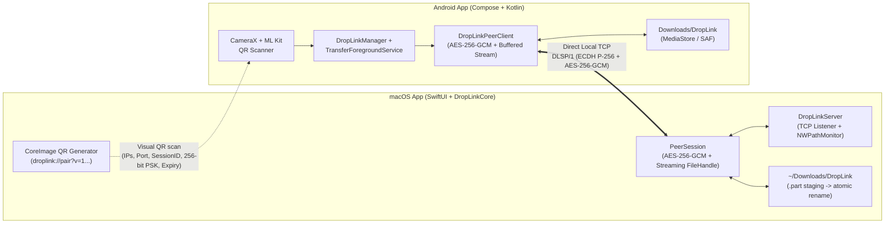

# DropLink Architecture

## Architectural Decision: Native Swift (macOS) + Native Kotlin (Android) over Shared `DLSP/1`

DropLink was specifically engineered around the constraints of developing on an **Intel MacBook Air running macOS 12.7.6 Monterey** with only **macOS Command Line Tools** installed (no full Xcode, no Rust toolchain, no Homebrew, and no Android Studio/SDK/NDK).

| Criterion | Native Swift/SwiftUI (macOS) + Kotlin/Compose (Android) | Tauri v2 + Rust |
| :--- | :--- | :--- |
| **Local Mac dependencies** | **Zero** beyond pre-installed macOS Command Line Tools (`swiftc`, `hdiutil`, `codesign`, `iconutil`) | Requires installing `rustup`, `rustc`, `cargo`, Node/npm, WebKit crates (~2 GB+) |
| **Build speed on Intel i5-5350U** | **~10–15 seconds** full release build + tests | 15–30 minutes cold build, high RAM pressure on 8 GB RAM |
| **macOS 12.7.6 compatibility** | Native `x86_64-apple-macos12.0` binary (~2 MB), native Dark/Light vibrancy, native Finder drag-and-drop | WKWebView overhead (~150 MB RAM), macOS 12 WebKit limitations |
| **Android UX & background reliability** | Native Material 3 Compose, CameraX + bundled ML Kit QR, `FOREGROUND_SERVICE_DATA_SYNC`, native MediaStore & SAF | Requires NDK/Rust cross-compilation + fragile JNI bridges for CameraX/SAF/ForegroundService |
| **Android build pipeline** | Standard cached Gradle + JDK 17 in GitHub Actions (free `ubuntu-latest`) | Complex Rust + NDK + Tauri CLI CI setup |

## System Overview

## Protocol Stack (`DLSP/1`)

See [`protocol/SPEC.md`](../protocol/SPEC.md) for the complete byte-level specification.

### Why Direct TCP Over WebRTC?
- **No Signaling / STUN / TURN**: Local Wi-Fi transfers never need external ICE servers or SDP signaling round-trips.
- **Full LAN Throughput**: Direct TCP sockets with `TCP_NODELAY` and 512 KiB socket buffers saturate local Wi-Fi links cleanly with OS-managed congestion control.
- **Simple Multiplexed Streaming**: A single authenticated, AES-256-GCM encrypted TCP connection multiplexes concurrent bidirectional file transfers (interleaved 256 KiB binary chunks keyed by 16-byte transfer UUID) alongside control frames (`PING`, `PONG`, `TRANSFER_OFFER`, `TRANSFER_ACCEPT`, `TRANSFER_CANCEL`, `TRANSFER_COMPLETE`, `TRANSFER_ACK`).

### Session & Reconnection Lifecycle

1. **Session Start (macOS)**:
   - Binds TCP listener on `0.0.0.0:0` (ephemeral OS port or user-configured port).
   - Generates random 128-bit `sessionId`, 256-bit `pairingSecret`, and `expiresAt` (default 10 minutes).
   - Enumerates active non-loopback IPv4 interfaces via `getifaddrs` (prioritizing Wi-Fi `en0`) and monitors interface transitions via `NWPathMonitor`.
2. **Initial Pairing (Android → macOS)**:
   - Android scans QR URI, tries advertised IPv4 addresses, and executes mutual-authenticated **ECDH P-256 + PSK** handshake (`mode = "pair"`).
   - Both sides derive `c2sKey`, `s2cKey`, and `reconnectKey` via **HKDF-SHA256**.
   - macOS issues a random `reconnectToken` mapped in memory to `(deviceId, reconnectKey)` for the active session.
3. **Graceful Reconnection & Byte-Offset Resume**:
   - If Wi-Fi briefly drops, Android's `ConnectivityManager.NetworkCallback` and exponential-backoff reconnector authenticate with `mode = "reconnect"` using `(reconnectToken, reconnectKey)` — succeeding even if the original QR code has since expired, while immediately failing if the user stopped or reset the session on macOS.
   - Any partially transferred file remains staged as `.droplink-<transferId>.part` + `.meta`. When re-offered with the same `transferId`, the receiver hashes the existing bytes and replies with `TRANSFER_ACCEPT(resumeOffset = existingSize)`, continuing seamlessly with full-file SHA-256 verification.

## Storage & Integrity Pipeline

- **Streaming I/O**: Chunks (256 KiB default) stream directly between disk and encrypted socket buffers; files are never buffered wholly in RAM.
- **Disk Space Guard**: Receivers check available storage (`statvfs` / `URLResourceValues` on macOS, `StatFs` on Android) before accepting an offer and reject cleanly with `INSUFFICIENT_STORAGE` if capacity is insufficient.
- **Filename Sanitization**: Remote filenames are stripped of path traversal (`../`, `/`, `\`), NUL/control characters, and leading dots while preserving spaces, Unicode, CJK, and emoji, and capped to 200 UTF-8 bytes preserving file extensions.
- **Atomic Commit & Non-Overwriting Deduplication**: Only after `bytesReceived == declaredSize` and incremental `SHA-256 == senderSha256` is the staging file atomically moved to `name.ext` (or `name (1).ext`, `name (2).ext` if a file already exists). Corrupted transfers delete the staging file immediately.
